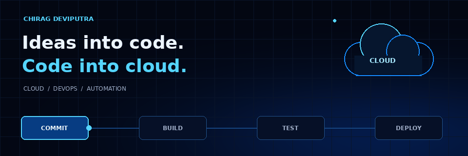
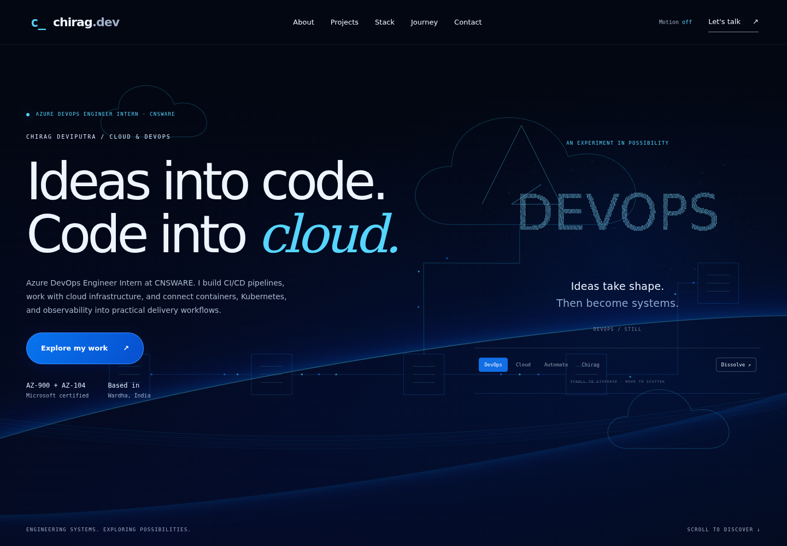
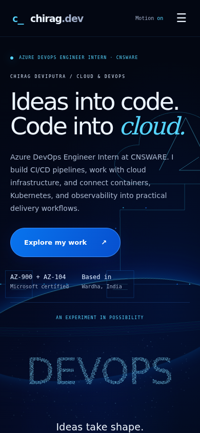

<div align="center">



# Chirag Deviputra · Cloud & DevOps

**An interactive portfolio where ideas become systems.**

Azure DevOps Engineer Intern · CNSWARE  
Microsoft Certified: AZ-900 & AZ-104 · Wardha, India

[Explore the projects](#selected-projects) · [Run locally](#quick-start) · [Customize](#make-it-yours) · [Contact](#connect)

</div>

---

## The experience

An electric-blue portfolio built with **Flask, Three.js and vanilla JavaScript**. Cloud infrastructure, deployment workflows and hands-on projects come together in a responsive interface.

- **Cloud delivery background** — original 3D cloud outlines, infrastructure nodes and moving deployment signals.
- **Scroll interaction** — the background follows scroll position; scrolling accelerates signals and disperses the hero particles.
- **Sand typography** — DEVOPS, CLOUD, AUTOMATE and CHIRAG dissolve and reform. Move the pointer to scatter the grains.
- **One-time title decoding** — headings animate on first reveal or interaction, without replaying on every hover.
- **Animated toolkit** — alternating tool marquees, hover states and category filters.
- **Project stories** — dedicated visuals, technology tags, repository links and detail dialogs.
- **Motion controls** — pause animations at any time; reduced-motion preferences are respected initially.
- **Contact form** — validated Flask endpoint with optional SMTP configuration and a direct-email alternative.

> The pipeline interaction is a visual demo. It does not execute builds or deploy infrastructure.

## Preview



<details>
<summary>View the mobile layout</summary>



</details>

## Selected projects

| Project | Focus | Technologies |
| :--- | :--- | :--- |
| [Azure GitOps Deployment Dashboard](https://github.com/Chirag-Deviputra/Azure-Gitops-Deployment-Dashboard) | Read-only deployment visibility, local kind cluster, operator-triggered Argo CD sync | Next.js, FastAPI, Kubernetes, Helm, GHCR, Prometheus, Grafana |
| [Dockerised Web App](https://github.com/Chirag-Deviputra/Dockerised-Web-App-Azure-Pipeline) | Automated tests → container build → Docker Hub → Render deploy hook | Node.js, Express, Docker, Azure DevOps |
| [Personal Agent · Corrupter](https://github.com/Chirag-Deviputra/Personal-Agent-Corrupter) | Local AI chat, browser voice, conversation history and confirmation-based email | Python, FastAPI, Ollama, SQLite |
| [Lenovo LOQ Experience](https://github.com/Chirag-Deviputra/Lenovo-LOQ-Frontend-Web-Project) | Independent product concept with a 240-frame scroll sequence | Next.js, TypeScript, Framer Motion, Tailwind CSS |
| [Docker E-Commerce](https://github.com/Chirag-Deviputra/docker-ecommerce-project) | Course-based storefront application with a containerized backend | Docker, Express, MongoDB, Redis, Stripe |

## Built with

| Layer | Stack |
| :--- | :--- |
| Backend | Python · Flask · python-dotenv |
| Interface | Jinja templates · HTML · CSS · JavaScript |
| Background | Self-hosted Three.js · WebGL |
| Particle typography | Canvas 2D |
| Contact | SMTP through Gmail, configured with environment variables |
| Visual identity | Near-black `#030712` · Electric blue `#0874ee` · Cyan `#55d5ff` · Off-white `#edf5ff` |

## Quick start

### Windows

1. Install **Python 3.10+**, including the Python launcher.
2. Download and extract this project.
3. Open `portfolio-web` and double-click **`start.bat`**.
4. Visit **http://127.0.0.1:5000**.

Keep the terminal open while viewing the site. The first run installs Python dependencies and needs internet access. Press **Ctrl+C** to stop the server.

### macOS / Linux

```bash
cd portfolio-web
python3 -m venv .venv
.venv/bin/python -m pip install -r requirements.txt
.venv/bin/python app.py
```

Open **http://127.0.0.1:5000**.

> Updating an older copy? Restart Flask and press **Ctrl+F5** in your browser. Keep **Motion on** to see the effects. The local development server is not a public deployment.

## Make it yours

| File | What to change |
| :--- | :--- |
| `portfolio-web/templates/index.html` | Profile, sections, GitOps feature and contact links |
| `portfolio-web/projects.json` | Four additional project descriptions, tags and repository links |
| `portfolio-web/templates/project-showcases.html` | Project layouts and illustrative visuals |
| `portfolio-web/static/css/cloud-theme.css` | Blue/cyan palette and surface colors |
| `portfolio-web/static/css/agency.css` | Editorial layout and project animations |
| `portfolio-web/static/js/ambient.js` | Three.js cloud delivery background |
| `portfolio-web/static/js/scroll-motion.js` | Shared scroll response |
| `portfolio-web/static/js/effects.js` | One-time title decoding and sand typography |
| `assets/cloud-devops-banner.gif` | This README's animated banner |

### Enable the contact form

Copy `portfolio-web/.env.example` to `portfolio-web/.env`, then configure `SENDER_EMAIL`, `SENDER_PASSWORD` and `RECEIVER_EMAIL`. For Gmail, use an app password for the sender account. Keep `.env` private.

Without credentials, the site displays a useful configuration message and offers a direct email link. No live email delivery is implied by the demo.

## Animation & accessibility

The website provides a Motion toggle, keyboard focus states, mobile layouts and readable title text beneath decorative decoding glyphs. The hero pauses offscreen; the background pauses in hidden tabs. A static gradient remains if WebGL is unavailable.

The README animation is a **self-contained GIF**, not embedded JavaScript. Upload **README.md, assets/ and previews/** together, preserving their relative paths. Its animation depicts a delivery workflow; it is not a live CI status indicator. A [static banner](assets/cloud-devops-banner.png) is also included.

## Documentation

- [Detailed setup and implementation notes](portfolio-web/README.md)
- [Verification and test scope](portfolio-web/VERIFICATION.md)

## Connect

[GitHub](https://github.com/Chirag-Deviputra) · [LinkedIn](https://www.linkedin.com/in/chirag-deviputra) · [Email](mailto:chiragdeviputra65@gmail.com)

<div align="center">

**Build. Observe. Improve. Repeat.**

</div>
